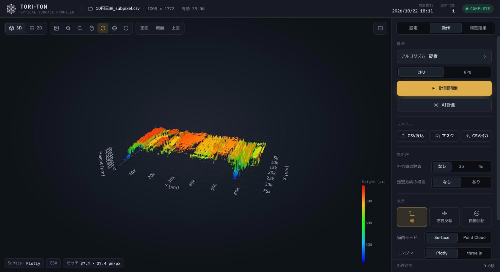
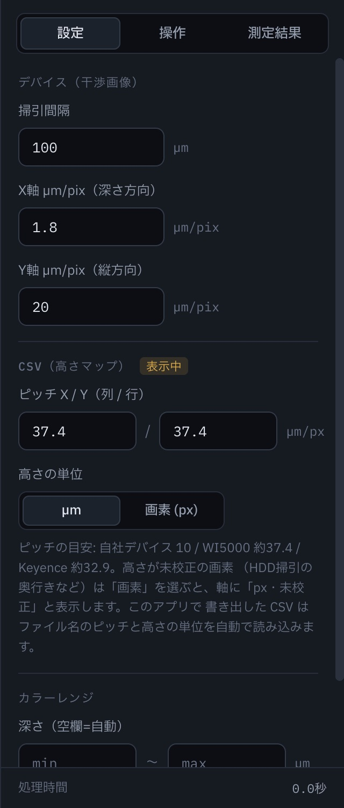
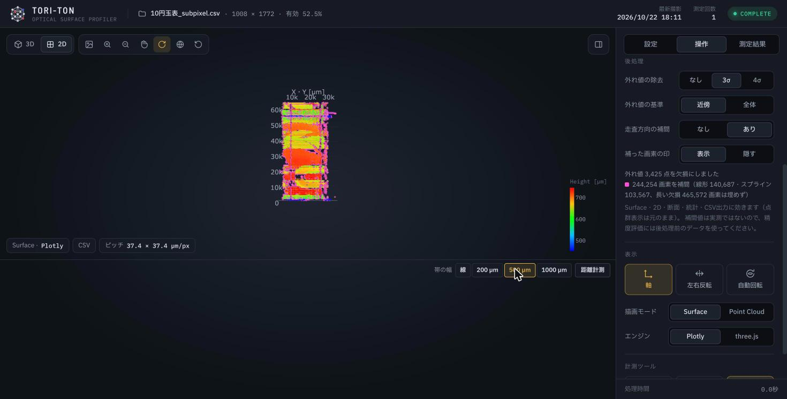
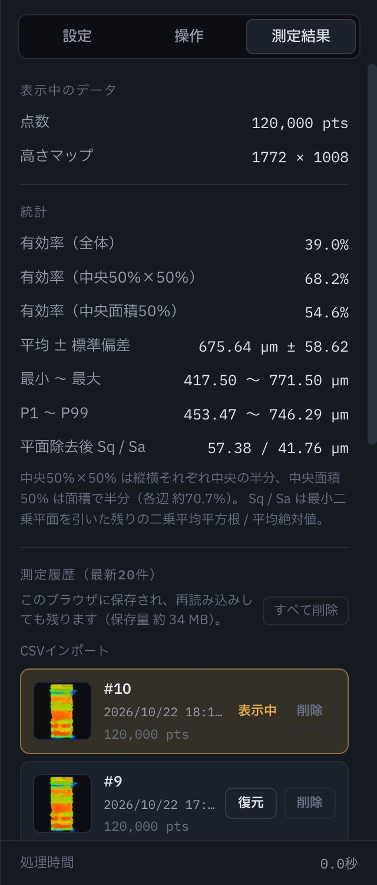
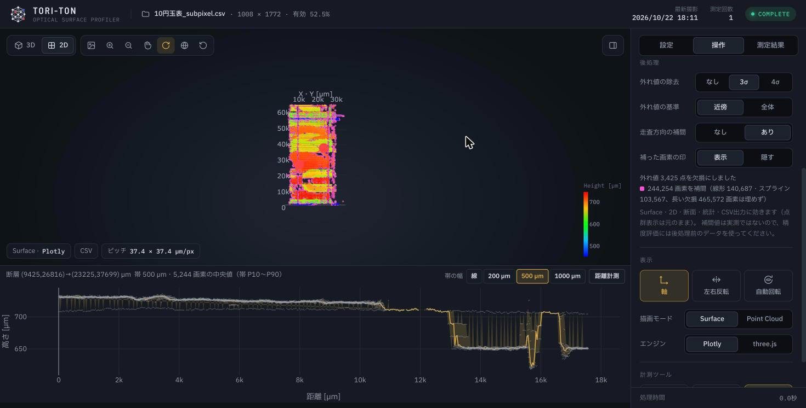

# UI仕様書 — Tori-Ton UI（Optical Device UI）

光学デバイス（干渉計測）で取得した画像から3次元の面形状を求め、ブラウザで表示・計測するアプリの画面仕様です。
新しく入った人が「どこに何があり、何をして、結果をどう読むか」を把握するための入口として書いています。

- 対象: 2026-10-22 時点の main
- 起動・配備は [デプロイ手順](デプロイ手順.md)、開発の進め方は [開発手順](開発手順.md)、通信の詳細は [API仕様書](API.md)、ファイル構成は [アーキテクチャ](ARCHITECTURE.md)
- 画面や仕様を変えたら、この資料も同じ PR で直してください

---

## 1. 全体像

```
ブラウザ（React + Plotly.js / three.js）  ── WebSocket /ws ──  バックエンド（FastAPI, Python）
   表示・計測・後処理・統計・CSV入出力                              前処理（古典的な画像処理）・AI推論
                                                                     data/row_data → data/result, data/mask_result
```

- **計測**: `data/row_data/` の干渉画像（掃引で撮った連続画像）から、各画像の各行で縞の位置を求め、高さマップと点群を作ります。方法は「古典的な前処理（計測開始）」と「AI推論（AI計測）」の2つ
- **読込**: 高さマップCSV（Keyence・WI5000・このアプリの書き出し）や、点群形式CSV、既存のマスク画像フォルダも表示できます
- 表示・後処理・統計・断面・計測はすべてブラウザ内で行います（バックエンドは計測のときだけ使う）



| 場所 | 中身 |
|---|---|
| 上端（ヘッダー） | ロゴ、表示中データの名前・グリッドの大きさ・有効率、最新撮影の日時、測定回数、状態（READY / RUNNING / COMPLETE） |
| 中央（プロット） | 3D / 2D の表示。左上にツールバー、3D のときは視点のプリセット、左下に表示情報のチップ、右下に色バー |
| 右（サイドパネル） | 「設定」「操作」「測定結果」の3タブ。右上のボタンで隠せる（隠すとプロットが全幅） |
| 下（断層パネル） | 2D 表示で「断層」をオンにしたときだけ出る断面グラフ |

---

## 2. データの種類と単位（最初に読む）

アプリは表示中のデータの**出どころ**を必ず持ち、それだけを根拠に µm へ換算します（`frontend/src/utils/units.ts`）。

| 出どころ | 何が入っているか | µm への換算 |
|---|---|---|
| **デバイス**（計測・AI計測・マスク読込） | 値 = 各行の縞の位置（画像の横方向の画素）。列 = 画像の縦方向の画素、行 = 掃引の何枚目か | 値 × 「X軸 µm/pix」（既定 1.8）、列 × 「Y軸 µm/pix」（既定 20）、行 × 「掃引間隔」（既定 100 µm） |
| **CSV（高さマップ）** | 値 = 高さ。欠損は `-9999.9` | 値はそのまま µm（「高さの単位」を画素にしたときは µm/px を掛ける。空欄なら「px・未校正」）、列・行 × ピッチ |
| **点群形式CSV** | 先頭行が `x,y,z`。x = 列の添字、y = 行の添字、z = 高さ µm。同じ (x, y) に複数の z を持てる（多層） | 高さマップは作らない（Surface・2D寸法・統計・後処理は使えない） |

- 設定タブの区画に「表示中」の印が付くので、いま効いている換算がどちらか分かります。プロット左下のチップにも出どころとピッチを表示します
- **このアプリで書き出した CSV は、ファイル名にピッチと高さの単位を残します**（例: `name_pitch10x10um_zum.csv`）。読み込むと自動で設定に反映されます
- 「左右反転」はデバイスでは**深さの反転**（最大値 − 値）、CSV では**左右の鏡映**です（意味が違う点に注意）
- 掃引間隔が空欄のときは行方向に仮の値（Y軸 µm/pix）を使い、軸に「仮定値」と出ます
- **複数層**: マスク画像の1行に縞が2本以上ある行は、高さマップでは欠損にします。そうした行が有効行の 5% 以上あるデータは「複数層」とみなし、CSV出力は層ごとの点（点群形式）になります

---

## 3. 画面ごとの仕様

### 3.1 プロット

| 操作 | 内容 |
|---|---|
| 3D / 2D | 2D は真上から見た表示（横・縦の2軸、高さは色バーで読む） |
| 描画モード（操作タブ） | **Surface**（高さマップを面で）／**Point Cloud**（点群） |
| エンジン（操作タブ） | **Plotly**（既定）／**three.js**（点群は最大100万点以上の高密度、Surface は CAD 風メッシュ。3D のとき） |
| ツールバー（左上） | 画像保存（黒背景の PNG 1920×1080）、ズームイン／アウト、パン、回転（ターンテーブル／自由回転）、視点リセット |
| 視点のプリセット（3D） | 正面（横方向×奥行き）・側面（縦方向×奥行き）・上面（横方向×縦方向） |
| 色バー（右下） | ドラッグで好きな位置へ動かせる。範囲は設定タブの「カラーレンジ」 |
| チップ（左下） | 描画モード・エンジン、データの出どころ、ピッチ（デバイスなら掃引間隔と µm/pix） |

- Plotly の Surface は**表示だけ**最大25万セルに間引きます（`utils/displayGrid.ts`。各ブロックの先頭の実測値で、平均はしない）。断面・統計・CSV出力・後処理は元の解像度で計算します
- 点群（Plotly）は最大12万点に間引いて表示します

### 3.2 設定タブ



| 区画 | 項目 | 既定 | 説明 |
|---|---|---|---|
| デバイス（干渉画像） | 掃引間隔 | 100 µm | 1枚ごとの掃引の間隔（行方向のピッチ） |
| | X軸 µm/pix（深さ方向） | 1.8 | 画像の横1画素あたりの深さ |
| | Y軸 µm/pix（縦方向） | 20 | 画像の縦1画素あたりの長さ（列方向のピッチ） |
| CSV（高さマップ） | ピッチ X / Y（列 / 行） | 10 / 10 µm/px | 目安: 自社デバイス 10、WI5000 約37.4、Keyence 約32.9 |
| | 高さの単位 | µm | 「画素 (px)」にすると、µm/px を入れれば換算、空欄なら「px・未校正」表示（HDD 掃引の奥行きなど） |
| カラーレンジ | 最小〜最大（空欄=自動） | 自動 | 欄名と単位は表示中のデータに合わせる（デバイス=深さ、CSV=高さ、未校正の画素なら px）。手動で指定した範囲の外はグレー。自動は外れ値を除いた範囲で色付けし、外れ値は端の色 |

設定はブラウザに保存され、再読み込みしても残ります。

### 3.3 操作タブ

**計測**

| 項目 | 内容 |
|---|---|
| アルゴリズム | 押すと選択ポップアップ。**現在選べるのは「硬貨」だけ**（他はバックエンドにあるが画面では選べない。5 章） |
| CPU / GPU | GPU は CUDA（CuPy）が使える PC のみ。Mac では CPU |
| 計測開始 | 確認の後、`data/row_data/` を古典的な前処理で処理し、結果を点群で表示 |
| AI計測 | 確認の後、AI推論（U-Net++ ResNet50）でマスクを作り、点群で表示 |

計測中はプロットに進捗（工程・％・経過時間）と**「中止」ボタン**が出ます。AI は1枚の推論が終わるごと、前処理は工程ごとに止まります。AI を中止したときは途中までのマスクを残しません。

**ファイル**

| ボタン | 内容 |
|---|---|
| CSV読込 | 高さマップCSV または点群形式CSV を読む |
| マスク | `data/mask_result/`（直近のAI計測の結果）を読み込んで Surface で表示 |
| CSV出力 | 表示中の高さマップを µm で書き出す（左右反転・後処理も反映、ピッチと単位をファイル名に記録）。点群形式CSV由来・複数層のデータは点群形式で書き出す |

**後処理**（高さマップがあるとき）



| 項目 | 内容 |
|---|---|
| 外れ値の除去 | なし／3σ／4σ。中央値から MAD×1.4826×σ を超えた点を欠損にする |
| 外れ値の基準 | **近傍**（既定）: 同じ走査行の左右 ±4 画素（自分を含む）の中央値と MAD で判定。突き出た点だけが外れ、凹凸・段差は残る／**全体**: 面全体の中央値（`tools/remove_outliers.py` と同じ）。帯状の大きな異常も拾うが、起伏の大きい面では本物の凹凸も消えうる |
| 走査方向の補間 | 行の並び（走査方向）の欠損を、3行以下は線形、4〜8行は局所スプライン（近傍の値から30%以上はみ出したら線形）で埋める。9行以上は埋めない（`tools/interpolate_scan.py` と同じ） |
| 補った画素の印 | 補間した画素をマゼンタで区別（Plotly は点、2D寸法はヒートマップの重ね、three.js は頂点色）。隠すこともできる |

- Surface・2D・断面・統計・CSV出力に効きます。**点群表示と測定履歴は元のまま**
- CSV出力のファイル名に処理を残します（近傍 `_hampel3`、全体 `_mad3`、補間 `_interp`）
- 新しいデータを開いたとき・履歴を復元したときは「なし」に戻ります

**表示**

| 項目 | 内容 |
|---|---|
| 軸 / 左右反転 / 自動回転 | 自動回転は表示中の 3D をターンテーブルのように回す |
| 奥行きの強調（点群） | ×0.5〜×20。点群の奥行き方向の見た目だけを伸ばす（値・ホバー・計測は変わらない）。ダブルクリックで ×1 |
| 描画モード・エンジン | 3.1 を参照 |
| しきい値（AI） | AI の結果のとき。推論をやり直さずに、確率マップから縞を抜き出し直す（0.05〜0.95） |
| 色分け（AI・点群） | 高さ／信頼度（AI の確率 0〜1。低い＝青いところは検出が怪しい） |

**計測ツール**

| ツール | 内容 |
|---|---|
| 距離 | プロット上でクリックした2点間の距離（µm） |
| 寸法 | 2D で両矢印をドラッグして任意2点間の寸法（ΔX・ΔY つき）。線は追加・削除できる。この間だけ本物の 2D ヒートマップで描く |
| 断層 | 2D で2点をクリックして断面を引く（3.5） |

### 3.4 測定結果タブ



**表示中のデータ**: 点数、高さマップの大きさ（行 × 列）

**統計**（表示と同じ µm 換算・反転・後処理で数える）

| 項目 | 定義 |
|---|---|
| 有効率（全体） | 全画素に対する値のある画素の割合 |
| 有効率（中央50%×50%） | 縦横それぞれ中央の半分の矩形で |
| 有効率（中央面積50%） | 面積で半分（各辺の中央 約70.7%）の矩形で |
| 平均 ± 標準偏差、最小〜最大、P1〜P99 | 高さの分布 |
| 平面除去後 Sq / Sa | 最小二乗平面を引いた残りの二乗平均平方根 / 平均絶対値（面のうねり・凹凸の大きさの目安） |

- 後処理を掛けているときは「後処理後の値（補間 N 画素を含む）」と注意が出ます
- デバイスのデータで Sa が 0.5 µm 未満のときは「縞位置の抽出ノイズ（約0.26 µm）に近く、粗さとしては読めない」と注意が出ます

**処理条件**: 計測・AI計測・マスク読込のとき、深さの求め方（サブピクセル／画素の重心／確率マップから再抽出）、アルゴリズム、CPU/GPU、ぼかしの σ、しきい値、モデル、処理日時など（結果フォルダの `depth_meta.json`）

**測定履歴**: 最新20件をこのブラウザ（IndexedDB）に保存し、再読み込みしても残ります。名前の変更（クリック）・復元・削除、「すべて削除」、保存量の表示。容量が足りないときは古いものから入れ替え、それでも入らなければ「未保存（この回だけ）」と出ます

### 3.5 断層パネル



2D 表示で「断層」をオンにし、プロット上で2点をクリックすると、下に断面が出ます（3点目のクリックで引き直し）。値の無い画素の上でも点を打てます（ドラッグでのパンは点にならない）。

| 項目 | 内容 |
|---|---|
| 帯の幅: 線 | 線に沿って一定間隔（ピッチ）で双一次補間した値。欠損の所で線が切れる |
| 帯の幅: 200 / 500 / 1000 µm | 線の両側 ±幅/2 の画素をすべて集めて横から見る。線は距離ごとの中央値、薄い帯は P10〜P90。2D 表示に帯の外形（破線）を描く |
| 距離計測 | 断面グラフ上で2点をクリックして距離とΔ深さを測る。端点はドラッグで調整 |

---

## 4. 計測の処理（バックエンド）

### 4.1 古典的な前処理（計測開始）

`data/row_data/` の画像（`img_NNN.png/bmp`、番号は数値順）を次の8工程で処理し、各画像の各行の縞の位置を求めます。

1. 画像の読み込み
2. 背景（全画像の中央値）
3. 背景差分（負は0）
4. 横方向の差分と強調（最大で正規化して 0.7 乗）
5. ガウス窓（画像の中央を重く見る。縦横、または横のみ）
6. 3次元のぼかし（掃引方向 σ、画像内 σ=7）とコントラスト正規化
7. ピーク検出（各行の最大値の位置、しきい値 10）。3点の放物線でサブピクセル位置も求める
8. ピーク帯マスク（各画像で縞が最も多い列の ±45 画素だけ残す）

| アルゴリズム | CPU（`backend/preprocessing_cpu_core.py` を設定違いで共有） | GPU |
|---|---|---|
| 硬貨 `coin` | 掃引方向 σ=10、窓は縦横（`preprocessing_cpu.py`） | `preprocessing_gpu.py` |
| 標準系 `elec` / `medical` / `semi` | 掃引方向 σ=1、窓は縦横（`preprocessing_std_cpu.py`） | `preprocessing_gpu.py` |
| 硬貨の別アプローチ `coin2` | 掃引方向 σ=1、窓は横のみ（`preprocessing_coin2_cpu.py`） | `preprocessing_coin2_gpu.py` |

結果は `data/result/` に、ピーク画像（`*_gausswin_stackblur_contrast_peak.png`）、`manifest.json`、`depth_grid.f32`（サブピクセルの深さ、[枚, 行]、欠損 NaN）、`depth_meta.json`（処理条件）を書きます。

### 4.2 AI推論（AI計測）

- モデル: U-Net++（ResNet50、`backend/models/best_model_resnet50.pth`）。Mac は MPS、CUDA があれば GPU
- 結果は `data/mask_result/` に、マスク画像（`*_mask.png`、しきい値 0.5）、確率マップ（`prob/*_prob.png`、確率×255、0.05 未満は0）、`depth_grid.f32`（確率加重重心）、`depth_meta.json`
- アプリの「しきい値（AI）」は確率マップから抜き出し直すので、推論をやり直す必要はありません

通信（WebSocket のコマンドとメッセージ）は [API仕様書](API.md) を参照してください。

---

## 5. 読み方の注意（必読）

- **補間した値は実測ではありません。** 精度評価（正解データとの比較）には後処理前のデータを使ってください。参照データで欠損を埋めたもの（`tools/fill_from_reference.py`）も同様です（循環評価になる）
- **有効率は領域を必ず添えて話してください。** 全体・中央50%×50%・中央面積50% で大きく違います（例: 1円玉裏 34% / 73% / 57%）
- **粗さ（Ra・Sa）は µm オーダーでは測れません。** 深さ分解能 1.8 µm/px に対し、縞位置の抽出ノイズが約0.26 µm。面形状・うねり（数十µm〜）の確認向けです
- **AI のマスクは真値ではありません。** 精度は正解データ（Keyence・WI5000）との比較（`tools/compare_to_reference.py`）で評価します
- **手法の比較は同じ画素どうしで。** 欠損の多い手法ほど全体の誤差が小さく見えます（共通の有効領域で比べる）
- **表示は間引いています。** 見た目の細かさと計算の解像度は別です（3.1）

---

## 6. 既知の制約・未解決

| 項目 | 内容 |
|---|---|
| GPU の深さ | GPU・TGV・論文用の前処理は `depth_grid.f32` を書かないので、高さは従来どおり 0.5 画素刻み |
| CPU と GPU の差 | 同じアルゴリズムでも CPU と GPU でぼかしの設定が違い、結果が一致しない（統一は特許・検証に関わるため保留） |
| アルゴリズムの選択 | 画面で選べるのは「硬貨」だけ（他はバックエンドにあり、画面では無効） |
| HDD などの多層データ | 古典的な前処理は画像中央を重く見るため、端にある縞を拾えない。多層は AI 計測で扱う |
| 10円のデバイスデータ | 走査の行ごとに段差（横縞）があり、帯の断面で約20 µm 低い集団が見える（データ側の性質。原因は未調査） |
| 距離計測と欠損 | 距離は高さが要るので、値の無い画素のクリックは無視する（断層の点は欠損の上でも打てる） |
| ヘッダーの最新撮影・測定回数 | CSV 読込でも更新される（計測時だけにする案は保留中） |
| 画面の重複 | 回転ボタンが2つ、メッシュ表示パネルと操作タブの重複など（整理は保留中） |

---

## 7. 用語

| 用語 | 意味 |
|---|---|
| 掃引 | 光学系を少しずつ動かしながら連続撮影すること。1枚 = 高さマップの1行 |
| 縞（干渉縞） | 干渉で明るくなる線。各行の縞の横位置が、その点の深さ |
| マスク | 画像の中で縞の画素を白にした二値画像（AI の出力） |
| 確率マップ | AI が各画素を縞だと思う確率（0〜1） |
| サブピクセル | 1画素より細かい位置（古典は3点の放物線、AI は確率加重重心） |
| 高さマップ | 行 × 列 のグリッドに高さ（デバイスは縞の位置）を入れたもの。欠損あり |
| 有効率 | 値のある画素の割合 |
| MAD | 中央絶対偏差。外れ値に引きずられにくいばらつきの尺度（×1.4826 で正規分布の σ 相当） |
| Sq / Sa | 面の凹凸の二乗平均平方根 / 平均絶対値（ここでは平面を引いた残りで計算） |
| P10 / P90 | 下から 10% / 90% の値 |

---

## 8. どこを直せばよいか

| 直したいもの | ファイル（`frontend/src/` から） |
|---|---|
| 状態と処理の配線（計測・読込・履歴） | `App.tsx` |
| 操作タブの各区画 | `components/operate/`（`MeasureSection` / `FileSection` / `PostprocessSection` / `DisplaySection` / `MeasureToolsSection`） |
| 設定タブ・測定結果タブ | `components/SettingsTab.tsx`・`components/ResultTab.tsx` |
| プロットの描画（Plotly） | `hooks/usePlotly.ts`（ツールバーは `components/plot/`） |
| three.js の表示 | `components/ThreePointCloudView.tsx`・`components/ThreeSurfaceMeshView.tsx` |
| 断層 | `hooks/useSlicePlot.ts`・`utils/bandSection.ts`・`components/SlicePanel.tsx` |
| 単位換算 | `utils/units.ts`（必ずここを通す） |
| 後処理・統計 | `utils/postprocess.ts`・`utils/surfaceStats.ts` |
| 結果フォルダの読み込み | `utils/pointCloud.ts` |
| 測定履歴 | `hooks/useCloudHistory.ts`・`utils/historyStore.ts` |
| 前処理・AI推論 | `backend/preprocessing_cpu_core.py` ほか・`backend/ai_inference.py`・`backend/depth_export.py`、通信は `backend/app.py` |

ロジックを変えたら `npm test`（`frontend/` で）を通し、画面に関わる変更はブラウザで一通り触ってください（[開発手順](開発手順.md)）。
